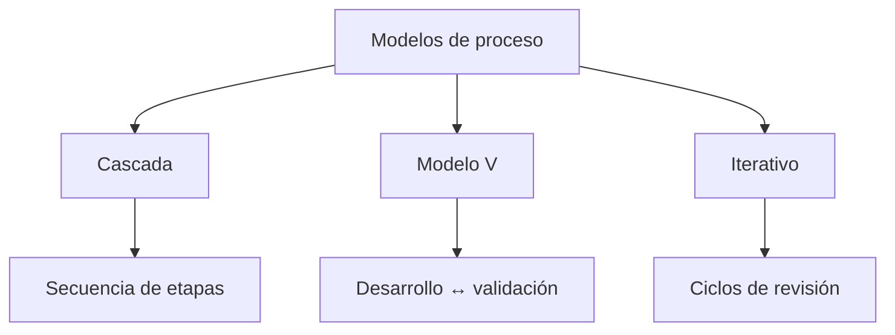

---
cssclasses:
  - ficha-clase
modulo: "Metodologías de desarrollo de software"
orden_portafolio: 02
seccion: "Fundamentos"
fuente: "Clase 2(1).pptx"
tipo: "Síntesis de clase"
---

# 02 / Modelos de procesos

> [!abstract] Cascada, modelo V y desarrollo iterativo
> **Módulo:** Fundamentos · **Material:** Clase 2 · **Año:** 2026

**Explorar:** [[#Contenido|Contenido]] · [[#Diagrama de síntesis|Diagrama]] · [[#Material visual de la clase|Diapositiva original]]

## Contenido

### ¿Qué es un modelo de proceso?

Un modelo de proceso establece cómo se organizan las etapas del desarrollo de software. Sirve para definir qué se hace primero, qué resultados deben obtenerse y cómo se comprueba que el trabajo va avanzando correctamente.

El material sitúa el paso hacia los modelos de proceso entre **1960 y 1970**, y destaca el desarrollo de los modelos de ciclo de vida entre **1970 y 1985**. La idea de fondo es pasar de «programar y corregir» a un trabajo con actividades más claras y relacionadas entre sí.

### Tres formas de organizar el desarrollo

| Modelo | Cómo funciona | Diferencia principal |
|---|---|---|
| **Cascada** | Divide el desarrollo en etapas secuenciales. | Se busca completar una fase antes de pasar a la siguiente. |
| **Modelo V** | Relaciona las actividades de desarrollo con sus pruebas de verificación y validación. | Hace más visible la relación entre lo que se define y lo que después se comprueba. |
| **Iterativo** | Trabaja mediante ciclos de desarrollo y revisión. | Permite revisar los resultados y utilizarlos en un nuevo ciclo. |

Ninguno de estos modelos cambia el objetivo de construir un sistema que cumpla sus requisitos. Lo que cambia es **cómo se organiza el trabajo para llegar a ese resultado**.

## Diagrama de síntesis

La diferencia entre cascada, modelo V e iterativo está principalmente en la secuencia del trabajo y en la forma de revisar los resultados.

## Qué conviene distinguir

El **ciclo de vida del software** comprende el recorrido general del producto, desde sus requisitos hasta su mantenimiento. Un **modelo de proceso** indica cómo se ordenan las actividades dentro de ese recorrido.

## Material visual de la clase

![[02 - RECURSOS/Imagenes originales/02_modelos.jpg]]

*Diapositiva 12 de la presentación original «Clase 2(1).pptx». Imagen utilizada para acompañar este tema.*

## Material y enlaces

- **Presentación original:** [[03 - FUENTES/Clase 2(1).pptx|Clase 2(1).pptx]]
- **Índice de fuentes:** [[02 - RECURSOS/Matriz de cobertura y rubrica|Ver las diez presentaciones]].
- **También puedes consultar:** [[02 - RECURSOS/Glosario|Glosario]] · [[02 - RECURSOS/Mapa del modulo|Mapa del módulo]].

[[01 - CLASES/01 - Introduccion y evolucion|← Anterior]] · [[00 - INICIO|Inicio]] · [[01 - CLASES/03 - Enfoques y metodologias|Siguiente →]]
