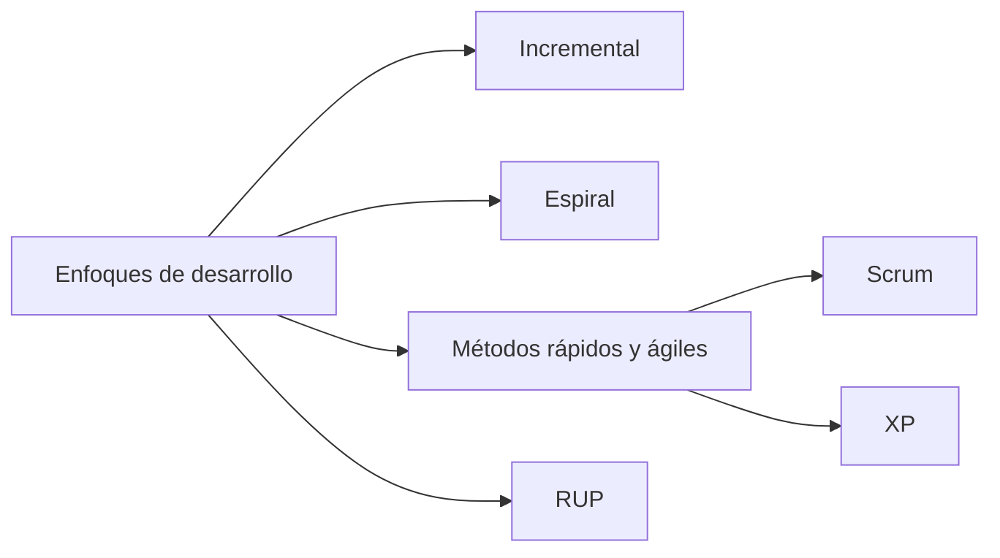

---
cssclasses:
  - ficha-clase
modulo: "Metodologías de desarrollo de software"
orden_portafolio: 03
seccion: "Fundamentos"
fuente: "Clase 3(1).pptx"
tipo: "Síntesis de clase"
---

# 03 / Enfoques y metodologías

> [!abstract] Incremental, espiral, Scrum, XP y RUP
> **Módulo:** Fundamentos · **Material:** Clase 3 · **Año:** 2026

**Explorar:** [[#Contenido|Contenido]] · [[#Diagrama de síntesis|Diagrama]] · [[#Material visual de la clase|Diapositiva original]]

## Contenido

### Desarrollo incremental y modelo en espiral

El **modelo incremental** divide el desarrollo en entregas sucesivas. En vez de esperar a tener todo el sistema terminado, se van incorporando nuevas funcionalidades en cada incremento.

El **modelo en espiral** también trabaja mediante ciclos, pero pone especial atención en analizar alternativas y riesgos antes de avanzar. Esto permite revisar decisiones durante el desarrollo, en lugar de tratarlas como definitivas desde el comienzo.

### Métodos rápidos, ágiles y otros enfoques

Con la evolución de los procesos aparecieron formas de trabajo que buscan responder mejor a los cambios y recibir retroalimentación con mayor frecuencia. Entre los enfoques revisados están:

| Enfoque | Qué lo caracteriza |
|---|---|
| **Incremental** | El software crece mediante entregas que agregan funcionalidad. |
| **Espiral** | Cada ciclo considera alternativas y riesgos del proyecto. |
| **Scrum** | Organiza el trabajo en ciclos breves, con revisión frecuente de resultados. |
| **Extreme Programming (XP)** | Da importancia a las prácticas de programación y a la retroalimentación continua. |
| **RUP** | Organiza el desarrollo mediante fases, casos de uso y decisiones de arquitectura. |

También se revisan las ventajas y limitaciones de las metodologías tradicionales. Esto es importante porque **no todos los proyectos requieren la misma forma de organización**.

## Diagrama de síntesis

Los enfoques se diferencian por la manera de planificar, entregar y revisar el trabajo. Que dos métodos utilicen ciclos no significa que funcionen exactamente igual.

## Una distinción útil

**Iterar** significa volver a trabajar sobre un resultado para revisarlo o mejorarlo. **Incrementar** significa agregar una parte nueva al producto. Ambas ideas pueden aparecer juntas, pero describen cosas distintas.

## Material visual de la clase

![[02 - RECURSOS/Imagenes originales/03_enfoques.jpg]]

*Diapositiva 10 de la presentación original «Clase 3(1).pptx». Imagen utilizada para acompañar este tema.*

## Material y enlaces

- **Presentación original:** [[03 - FUENTES/Clase 3(1).pptx|Clase 3(1).pptx]]
- **Índice de fuentes:** [[02 - RECURSOS/Matriz de cobertura y rubrica|Ver las diez presentaciones]].
- **También puedes consultar:** [[02 - RECURSOS/Glosario|Glosario]] · [[02 - RECURSOS/Mapa del modulo|Mapa del módulo]].

[[01 - CLASES/02 - Modelos de procesos|← Anterior]] · [[00 - INICIO|Inicio]] · [[01 - CLASES/04 - RUP concepcion|Siguiente →]]
