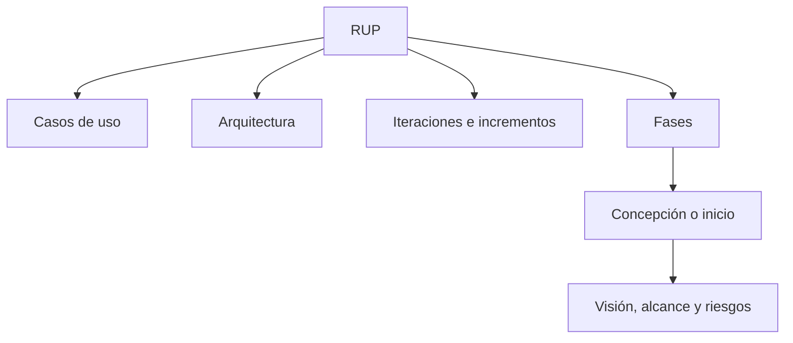

---
cssclasses:
  - ficha-clase
modulo: "Metodologías de desarrollo de software"
orden_portafolio: 04
seccion: "Fundamentos"
fuente: "Clase 4(1).pptx"
tipo: "Síntesis de clase"
---

# 04 / RUP: concepción

> [!abstract] Características de RUP y fase de inicio
> **Módulo:** Fundamentos · **Material:** Clase 4 · **Año:** 2026

**Explorar:** [[#Contenido|Contenido]] · [[#Diagrama de síntesis|Diagrama]] · [[#Material visual de la clase|Diapositiva original]]

## Contenido

### ¿Cómo funciona RUP?

El **Proceso Unificado de Rational (RUP)** propone una forma de organizar el desarrollo utilizando fases, actividades y artefactos. No se limita a indicar una lista de tareas: también establece qué se debe revisar y qué resultados deberían quedar documentados durante el proyecto.

Sus características principales son:

- **Dirigido por casos de uso:** las funcionalidades se relacionan con lo que necesitan realizar los usuarios o actores.
- **Centrado en la arquitectura:** la estructura del sistema es una base importante para tomar decisiones de diseño.
- **Iterativo e incremental:** el trabajo se desarrolla en ciclos y el producto puede ir creciendo progresivamente.
- **Organizado en fases:** cada fase tiene objetivos y resultados que permiten evaluar el avance.

### Concepción o inicio: definir lo que se quiere hacer

La primera fase de RUP se utiliza para entender el problema y establecer una visión general del proyecto. Aquí se define el **alcance inicial**, se identifican los actores y las necesidades más importantes, y se revisan los principales riesgos.

En esta etapa todavía no se trata de construir todo el sistema. Primero debe quedar suficientemente claro **qué se pretende desarrollar y si tiene sentido continuar**. Para eso se consideran los artefactos y criterios de evaluación asociados a la fase de inicio.

## Diagrama de síntesis

RUP conecta las necesidades del sistema con su arquitectura y organiza el trabajo en ciclos, sin perder de vista los objetivos de cada fase.

## Por qué importa la fase de inicio

Si no están definidos el problema, el alcance y los riesgos principales, las siguientes fases pueden avanzar sobre decisiones poco claras. La concepción busca establecer esa base antes de profundizar en el desarrollo.

## Material visual de la clase

![[02 - RECURSOS/Imagenes originales/04_rup_concepcion.jpg]]

*Diapositiva 12 de la presentación original «Clase 4(1).pptx». Imagen utilizada para acompañar este tema.*

## Material y enlaces

- **Presentación original:** [[03 - FUENTES/Clase 4(1).pptx|Clase 4(1).pptx]]
- **Índice de fuentes:** [[02 - RECURSOS/Matriz de cobertura y rubrica|Ver las diez presentaciones]].
- **También puedes consultar:** [[02 - RECURSOS/Glosario|Glosario]] · [[02 - RECURSOS/Mapa del modulo|Mapa del módulo]].

[[01 - CLASES/03 - Enfoques y metodologias|← Anterior]] · [[00 - INICIO|Inicio]] · [[01 - CLASES/05 - RUP fases y artefactos|Siguiente →]]
