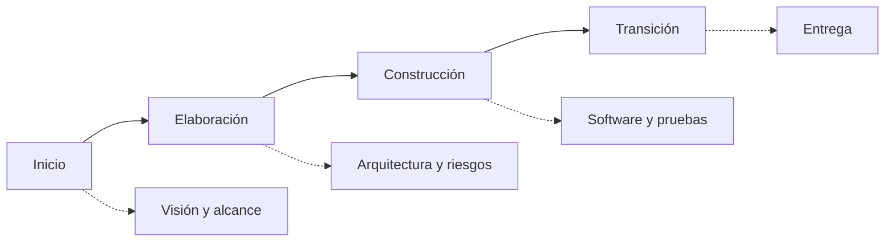

---
cssclasses:
  - ficha-clase
modulo: "Metodologías de desarrollo de software"
orden_portafolio: 05
seccion: "Fundamentos"
fuente: "Clase 5(1).pptx"
tipo: "Síntesis de clase"
---

# 05 / RUP: fases y artefactos

> [!abstract] Elaboración, construcción y transición
> **Módulo:** Fundamentos · **Material:** Clase 5 · **Año:** 2026

**Explorar:** [[#Contenido|Contenido]] · [[#Diagrama de síntesis|Diagrama]] · [[#Material visual de la clase|Diapositiva original]]

## Contenido

### Las fases que siguen después del inicio

Una vez planteada la visión del proyecto, RUP continúa con **elaboración, construcción y transición**. Cada una cumple una función distinta, aunque todas forman parte de un mismo proceso de desarrollo.

| Fase | Trabajo principal | Qué debería quedar definido o disponible |
|---|---|---|
| **Elaboración** | Profundizar requisitos, arquitectura y riesgos. | Una base técnica suficientemente clara para construir. |
| **Construcción** | Desarrollar, integrar y probar las funcionalidades. | Un producto funcional que avanza por incrementos. |
| **Transición** | Preparar la entrega y el uso del sistema. | Un producto disponible para los usuarios y ajustado para su puesta en marcha. |

### ¿Qué papel tienen los artefactos?

Los **artefactos** son los documentos, modelos u otros resultados que se generan durante el trabajo. Permiten dejar registro de las decisiones y comprobar si una fase está cumpliendo sus objetivos.

Por eso, además de describir las actividades, RUP considera criterios para revisar el avance. La idea no es completar fases solo porque se terminó una lista de tareas, sino verificar que existen resultados que permiten continuar.

## Diagrama de síntesis

Las cuatro fases de RUP muestran un recorrido general: definir el proyecto, preparar su base técnica, construirlo y llevarlo a los usuarios.

## Cómo se relacionan las fases

Elaboración, construcción y transición no significan que el análisis o las pruebas desaparezcan después de una etapa. En RUP, el trabajo es **iterativo e incremental**, por lo que distintas actividades pueden volver a aparecer a medida que avanza el producto.

## Material visual de la clase

![[02 - RECURSOS/Imagenes originales/05_rup_fases.jpg]]

*Diapositiva 8 de la presentación original «Clase 5(1).pptx». Imagen utilizada para acompañar este tema.*

## Material y enlaces

- **Presentación original:** [[03 - FUENTES/Clase 5(1).pptx|Clase 5(1).pptx]]
- **Índice de fuentes:** [[02 - RECURSOS/Matriz de cobertura y rubrica|Ver las diez presentaciones]].
- **También puedes consultar:** [[02 - RECURSOS/Glosario|Glosario]] · [[02 - RECURSOS/Mapa del modulo|Mapa del módulo]].

[[01 - CLASES/04 - RUP concepcion|← Anterior]] · [[00 - INICIO|Inicio]] · [[01 - CLASES/06 - Cascada requisitos|Siguiente →]]
