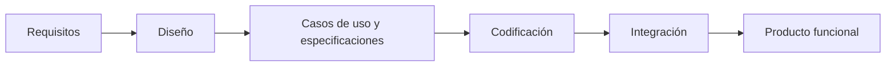

---
cssclasses:
  - ficha-clase
modulo: "Metodologías de desarrollo de software"
orden_portafolio: 08
seccion: "Cascada"
fuente: "Clase 2 --- Cascada3(1).pptx"
tipo: "Síntesis de clase"
---

# 08 / Cascada: implementación

> [!abstract] Transformar requisitos y diseño en código
> **Módulo:** Cascada · **Material:** Cascada 3 · **Año:** 2026

**Explorar:** [[#Contenido|Contenido]] · [[#Diagrama de síntesis|Diagrama]] · [[#Material visual de la clase|Diapositiva original]]

## Contenido

### Pasar del diseño a la implementación

La **implementación** es la etapa en que las especificaciones comienzan a transformarse en software. Los programadores utilizan lo definido en los requisitos y en el diseño para escribir las instrucciones que permitirán que el sistema funcione.

El trabajo puede dividirse en componentes o partes más pequeñas, que luego se integran. Para que esa integración tenga sentido, las decisiones de arquitectura y las funciones esperadas deben estar claras desde las etapas anteriores.

### ¿Cómo sabemos qué se debe programar?

Los **casos de uso** permiten conectar los objetivos de los actores con el comportamiento esperado del sistema. Por eso vuelven a aparecer en esta etapa: ayudan a identificar qué funciones deben implementarse y qué acciones debe contemplar el código.

La codificación no debería depender solamente de lo que el programador supone que necesita el usuario. Su referencia principal es la documentación construida durante el análisis y el diseño.

## Diagrama de síntesis

La implementación toma lo definido en etapas anteriores y lo convierte en componentes que después se integran para formar el producto.

## De la definición a la ejecución

**Requisitos, diseño y código** no son partes aisladas. Los requisitos señalan lo que se necesita; el diseño organiza la solución; y la implementación la transforma en instrucciones ejecutables.

## Material visual de la clase

![[02 - RECURSOS/Imagenes originales/08_implementacion.jpg]]

*Diapositiva 8 de la presentación original «Clase 2 --- Cascada3(1).pptx». Imagen utilizada para acompañar este tema.*

## Material y enlaces

- **Presentación original:** [[03 - FUENTES/Clase 2 --- Cascada3(1).pptx|Clase 2 --- Cascada3(1).pptx]]
- **Índice de fuentes:** [[02 - RECURSOS/Matriz de cobertura y rubrica|Ver las diez presentaciones]].
- **También puedes consultar:** [[02 - RECURSOS/Glosario|Glosario]] · [[02 - RECURSOS/Mapa del modulo|Mapa del módulo]].

[[01 - CLASES/07 - Cascada diseno y UML|← Anterior]] · [[00 - INICIO|Inicio]] · [[01 - CLASES/09 - Cascada pruebas|Siguiente →]]
