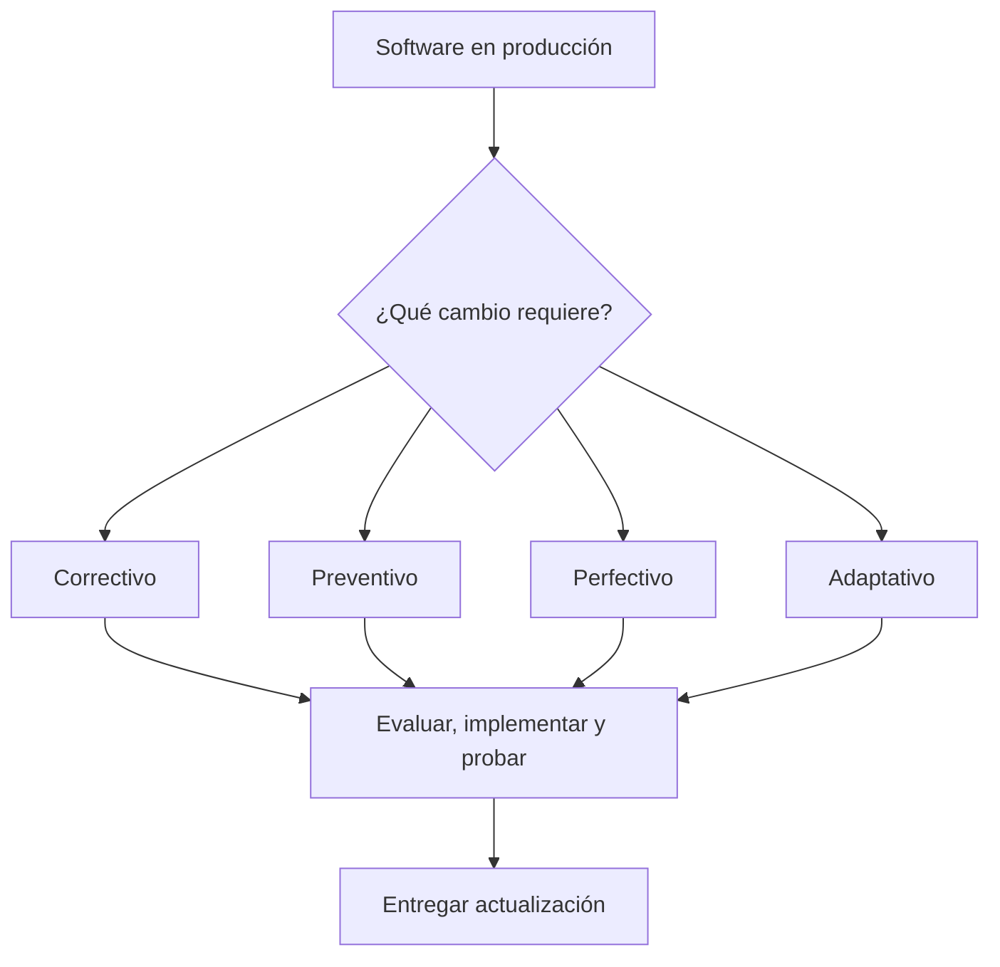

---
cssclasses:
  - ficha-clase
modulo: "Metodologías de desarrollo de software"
orden_portafolio: 10
seccion: "Cascada"
fuente: "Clase 3 --- Cascada5(1).pptx"
tipo: "Síntesis de clase"
---

# 10 / Cascada: despliegue y mantenimiento

> [!abstract] Entrega, soporte y cuatro tipos de mantenimiento
> **Módulo:** Cascada · **Material:** Cascada 5 · **Año:** 2026

**Explorar:** [[#Contenido|Contenido]] · [[#Diagrama de síntesis|Diagrama]] · [[#Material visual de la clase|Diapositiva original]]

## Contenido

### Entrega y puesta en marcha

La etapa de **despliegue** corresponde a la entrega y puesta en funcionamiento del sistema. Pero el trabajo no necesariamente termina ahí. Una vez que el software está en uso, pueden aparecer fallos, nuevas necesidades o cambios en el entorno que obliguen a modificarlo.

### Los cuatro tipos de mantenimiento

| Tipo | Para qué se utiliza |
|---|---|
| **Correctivo** | Corregir fallos o errores que afectan el funcionamiento. |
| **Preventivo** | Detectar y resolver problemas potenciales antes de que se conviertan en fallos. |
| **Perfectivo** | Mejorar funciones existentes o incorporar características que responden a nuevas necesidades. |
| **Adaptativo** | Ajustar el software cuando cambian las tecnologías, las plataformas o las condiciones de su entorno. |

No se trata de cuatro nombres para una misma tarea: cada tipo responde a un motivo diferente para intervenir el sistema.

### ¿Cómo se gestiona un cambio?

El material presenta un recorrido de mantenimiento con siete pasos: **identificación, análisis, diseño, implementación, pruebas del sistema, pruebas de aceptación y entrega**. Antes de publicar una modificación, es necesario comprender qué se cambiará y revisar que el resultado funcione.

También se destaca la importancia de mantener la documentación al día, realizar controles de calidad y considerar tareas como **actualizaciones, copias de seguridad y revisiones de seguridad**. El mantenimiento puede representar un costo considerable, especialmente cuando el sistema envejece o depende de tecnologías que cambian con el tiempo.

## Diagrama de síntesis

Después de la entrega, el software puede necesitar correcciones, mejoras y adaptaciones. El mantenimiento permite gestionar esos cambios de forma ordenada.

## Después de ponerlo en producción

Un sistema no se mantiene solamente cuando falla. También requiere prevenir problemas, incorporar mejoras y adaptarse a cambios externos. La documentación y las pruebas siguen siendo relevantes durante esta etapa.

## Material visual de la clase

![[02 - RECURSOS/Imagenes originales/10_mantenimiento.jpg]]

*Diapositiva 7 de la presentación original «Clase 3 --- Cascada5(1).pptx». Imagen utilizada para acompañar este tema.*

## Material y enlaces

- **Presentación original:** [[03 - FUENTES/Clase 3 --- Cascada5(1).pptx|Clase 3 --- Cascada5(1).pptx]]
- **Índice de fuentes:** [[02 - RECURSOS/Matriz de cobertura y rubrica|Ver las diez presentaciones]].
- **También puedes consultar:** [[02 - RECURSOS/Glosario|Glosario]] · [[02 - RECURSOS/Mapa del modulo|Mapa del módulo]].

[[01 - CLASES/09 - Cascada pruebas|← Anterior]] · [[00 - INICIO|Inicio]] · —
