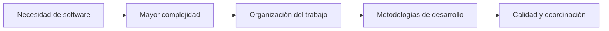

---
cssclasses:
  - ficha-clase
modulo: "Metodologías de desarrollo de software"
orden_portafolio: 01
seccion: "Fundamentos"
fuente: "Clase 1(1).pptx"
tipo: "Síntesis de clase"
---

# 01 / Introducción y evolución

> [!abstract] De las técnicas de codificación a procesos de desarrollo
> **Módulo:** Fundamentos · **Material:** Clase 1 · **Año:** 2026

**Explorar:** [[#Contenido|Contenido]] · [[#Diagrama de síntesis|Diagrama]] · [[#Material visual de la clase|Diapositiva original]]

## Contenido

### ¿Por qué necesitamos metodologías?

Desarrollar software no consiste solamente en escribir código. Primero hay que tener claro qué se quiere resolver, cómo se va a organizar el trabajo y qué se necesita para llegar a un resultado que realmente funcione.

Las **metodologías de desarrollo** permiten ordenar ese proceso. Definen una forma de trabajar y ayudan a coordinar tareas, personas y decisiones, en lugar de avanzar improvisando a medida que aparecen los problemas.

### De la codificación a los procesos de desarrollo

En las primeras etapas de la historia del software, especialmente entre **1950 y 1960**, el trabajo estaba mucho más centrado en las técnicas de programación. Con el tiempo, los sistemas se hicieron más complejos y ya no bastaba con programar y corregir errores sobre la marcha.

A partir de esa necesidad comenzaron a tomar importancia los modelos que organizan el desarrollo en actividades como el análisis, el diseño, la implementación y las pruebas. No reemplazan la programación: **le dan una estructura dentro de un proceso más amplio**.

## Diagrama de síntesis

El cambio importante no fue dejar de programar, sino entender que escribir código es solo una de las actividades necesarias para construir software.

## La idea principal

Una metodología ayuda a definir **cómo se trabaja**, mientras que las técnicas de programación se ocupan de **cómo se construye el código**. Son cosas relacionadas, pero no significan lo mismo.

## Material visual de la clase

![[02 - RECURSOS/Imagenes originales/01_introduccion.jpg]]

*Diapositiva 7 de la presentación original «Clase 1(1).pptx». Imagen utilizada para acompañar este tema.*

## Material y enlaces

- **Presentación original:** `Clase 1(1).pptx` (no publicado)
- **Índice de fuentes:** [[02 - RECURSOS/Matriz de cobertura y rubrica|Ver las diez presentaciones]].
- **También puedes consultar:** [[02 - RECURSOS/Glosario|Glosario]] · [[02 - RECURSOS/Mapa del modulo|Mapa del módulo]].

— · [[index|Inicio]] · [[01 - CLASES/02 - Modelos de procesos|Siguiente →]]
