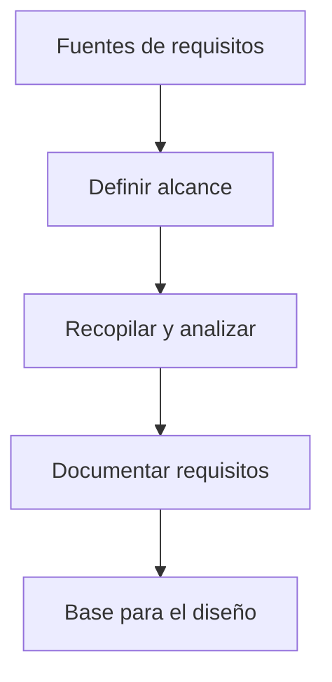

---
cssclasses:
  - ficha-clase
modulo: "Metodologías de desarrollo de software"
orden_portafolio: 06
seccion: "Cascada"
fuente: "Clase 1 --- Cascada1(1).pptx"
tipo: "Síntesis de clase"
---

# 06 / Cascada: requisitos

> [!abstract] Recolección y análisis de necesidades
> **Módulo:** Cascada · **Material:** Cascada 1 · **Año:** 2026

**Explorar:** [[#Contenido|Contenido]] · [[#Diagrama de síntesis|Diagrama]] · [[#Material visual de la clase|Diapositiva original]]

## Contenido

### El punto de partida del modelo en cascada

El **modelo en cascada** organiza el desarrollo en etapas consecutivas. En su planteamiento clásico, una etapa comienza una vez completada la anterior. Por eso es importante definir correctamente las necesidades del sistema desde el inicio: lo que se establezca aquí servirá de base para el diseño y las etapas siguientes.

### Requisitos funcionales y no funcionales

Los requisitos indican qué se espera del sistema y bajo qué condiciones debe funcionar.

| Tipo | Qué define | Ejemplo visto en el material |
|---|---|---|
| **Funcional** | Lo que el sistema debe hacer. | Permitir iniciar sesión con usuario y contraseña. |
| **No funcional** | Condiciones o características que debe cumplir. | Seguridad, confiabilidad o rendimiento. |

La diferencia es sencilla: **una función describe una acción del sistema; una condición no funcional establece una exigencia sobre su funcionamiento**.

### ¿Cómo se recopilan?

El levantamiento de requisitos no consiste en anotar la primera idea que aparezca. Se necesita identificar fuentes de información, definir el alcance y documentar lo que realmente se requiere.

El proceso se presenta en cuatro pasos:

1. **Identificar las fuentes:** usuarios, interesados, sistemas y documentos existentes, entre otros.
2. **Definir el alcance:** establecer los objetivos, los límites y lo que se espera entregar.
3. **Planificar la recopilación:** decidir qué información hace falta y cómo se va a obtener.
4. **Documentar los requisitos:** dejar una base que pueda revisarse y precisarse.

Entre las técnicas tratadas se encuentran las **entrevistas, cuestionarios, lluvia de ideas, prototipado, revisión de documentos y casos de uso**.

## Diagrama de síntesis

La calidad de los requisitos condiciona las etapas posteriores: un diseño claro es difícil de conseguir si todavía no se entiende qué necesita el sistema.

## Qué debe quedar claro

Antes de diseñar es necesario distinguir las funcionalidades, las restricciones y los límites del proyecto. El documento de requisitos permite dejar constancia de esa información y revisarla cuando sea necesario.

## Material visual de la clase

![[02 - RECURSOS/Imagenes originales/06_cascada_etapas.jpg]]

*Diapositiva 6 de la presentación original «Clase 1 --- Cascada1(1).pptx». Imagen utilizada para acompañar este tema.*

## Material y enlaces

- **Presentación original:** `Clase 1 --- Cascada1(1).pptx` (no publicado)
- **Índice de fuentes:** [[02 - RECURSOS/Matriz de cobertura y rubrica|Ver las diez presentaciones]].
- **También puedes consultar:** [[02 - RECURSOS/Glosario|Glosario]] · [[02 - RECURSOS/Mapa del modulo|Mapa del módulo]].

[[01 - CLASES/05 - RUP fases y artefactos|← Anterior]] · [[index|Inicio]] · [[01 - CLASES/07 - Cascada diseno y UML|Siguiente →]]
