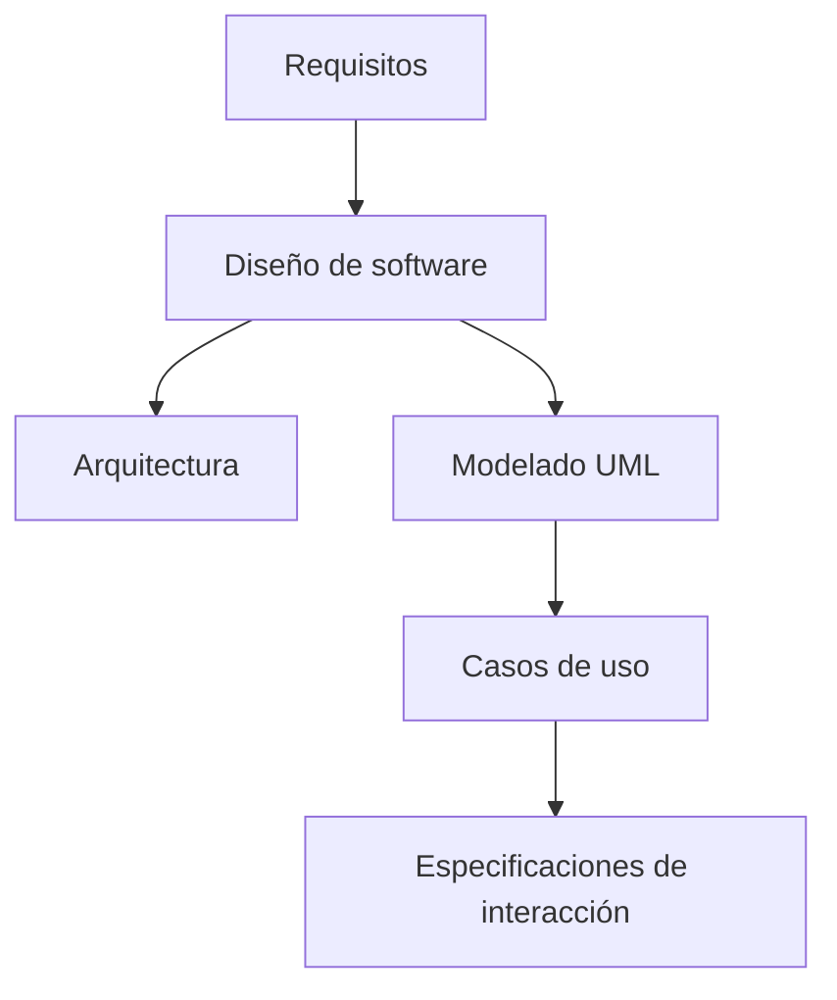

---
cssclasses:
  - ficha-clase
modulo: "Metodologías de desarrollo de software"
orden_portafolio: 07
seccion: "Cascada"
fuente: "Clase 2 --- Cascada2(1).pptx"
tipo: "Síntesis de clase"
---

# 07 / Cascada: diseño y UML

> [!abstract] Arquitectura, modelado y casos de uso
> **Módulo:** Cascada · **Material:** Cascada 2 · **Año:** 2026

**Explorar:** [[#Contenido|Contenido]] · [[#Diagrama de síntesis|Diagrama]] · [[#Material visual de la clase|Diapositiva original]]

## Contenido

### Diseñar antes de programar

Con los requisitos definidos, la siguiente etapa es decidir **cómo estará organizado el sistema**. El diseño considera la arquitectura, los componentes, la interfaz y las decisiones técnicas necesarias para desarrollar la solución.

Esto no es lo mismo que empezar a escribir código. Primero se prepara una representación de la solución, de manera que las distintas partes del sistema tengan una estructura coherente.

### UML: representar el sistema de forma gráfica

El **Lenguaje Unificado de Modelado (UML)** utiliza diagramas para representar y comunicar aspectos de un sistema. Es una forma de expresar el diseño y facilita que quienes participan en el proyecto puedan revisar las mismas decisiones.

### Casos de uso

Los **casos de uso** describen cómo interactúa un actor con el sistema para alcanzar un objetivo. Pueden representarse mediante diagramas y también detallarse por escrito.

En el material se utilizan ejemplos de **matrícula** y **consultas académicas**. Por ejemplo, un profesor solicita estadísticas, se identifica y luego selecciona la información que necesita. Este tipo de descripción permite identificar funciones y relacionarlas con los requisitos.

Un diagrama muestra la relación general entre actores y funciones; la **especificación textual** explica con más detalle la interacción esperada.

## Diagrama de síntesis

El diseño utiliza los requisitos como punto de partida y los transforma en una descripción más concreta de cómo se organizará el sistema.

## Lo importante del modelado

UML no es un lenguaje de programación. Su función es **representar** el sistema. Los casos de uso, en particular, ayudan a mantener la relación entre lo que necesitan los usuarios y lo que posteriormente deberá implementarse y probarse.

## Material visual de la clase

![[02 - RECURSOS/Imagenes originales/07_casos_uso.jpg]]

*Diapositiva 12 de la presentación original «Clase 2 --- Cascada2(1).pptx». Imagen utilizada para acompañar este tema.*

## Material y enlaces

- **Presentación original:** `Clase 2 --- Cascada2(1).pptx` (no publicado)
- **Índice de fuentes:** [[02 - RECURSOS/Matriz de cobertura y rubrica|Ver las diez presentaciones]].
- **También puedes consultar:** [[02 - RECURSOS/Glosario|Glosario]] · [[02 - RECURSOS/Mapa del modulo|Mapa del módulo]].

[[01 - CLASES/06 - Cascada requisitos|← Anterior]] · [[index|Inicio]] · [[01 - CLASES/08 - Cascada implementacion|Siguiente →]]
