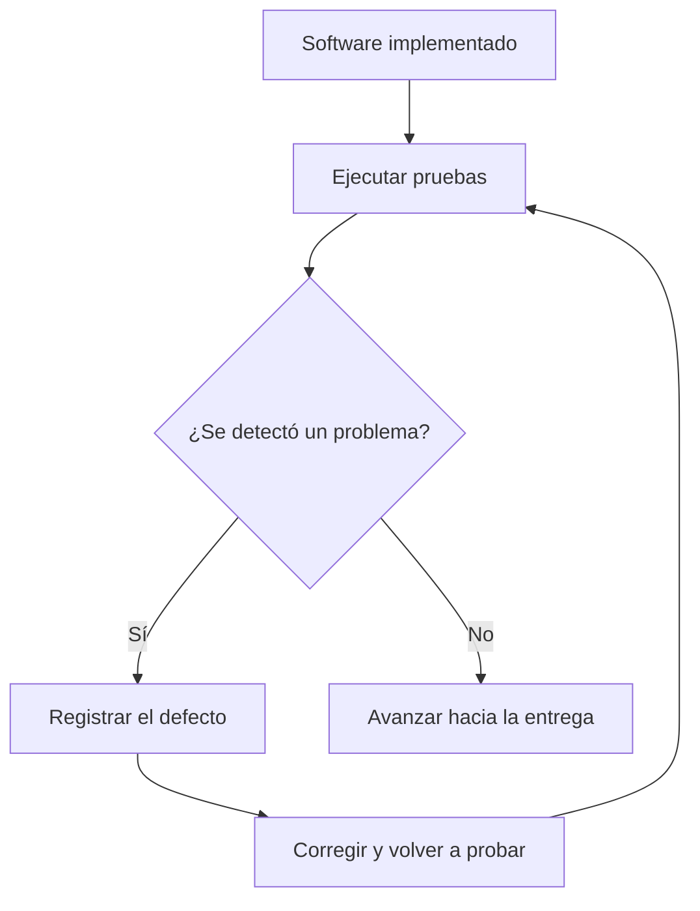

---
cssclasses:
  - ficha-clase
modulo: "Metodologías de desarrollo de software"
orden_portafolio: 09
seccion: "Cascada"
fuente: "Clase 3 --- Cascada4(1).pptx"
tipo: "Síntesis de clase"
---

# 09 / Cascada: pruebas

> [!abstract] Validación, control de calidad y defectos
> **Módulo:** Cascada · **Material:** Cascada 4 · **Año:** 2026

**Explorar:** [[#Contenido|Contenido]] · [[#Diagrama de síntesis|Diagrama]] · [[#Material visual de la clase|Diapositiva original]]

## Contenido

### ¿Para qué se realizan las pruebas?

Una vez que el software ha sido implementado, es necesario comprobar que funciona de acuerdo con lo esperado. En el modelo en cascada, esta etapa permite **detectar errores antes de la entrega** y revisar el comportamiento de las distintas partes del sistema.

El equipo encargado del control de calidad ejecuta las pruebas, identifica fallos y comunica los resultados para que puedan corregirse.

### Registrar los errores también es parte de la prueba

Encontrar un problema no es suficiente si después nadie sabe exactamente qué ocurrió. Los errores detectados deben quedar documentados con claridad, para que el equipo pueda revisarlos y para que esa información sirva ante situaciones similares.

Cuando aparece un fallo importante, puede ser necesario volver a revisar decisiones tomadas en etapas anteriores. Después de corregirlo, corresponde **probar nuevamente** para comprobar el resultado.

## Diagrama de síntesis

Las pruebas conectan el software construido con el comportamiento esperado. Si aparece una diferencia, esa información debe registrarse y volver al proceso de corrección.

## Por qué es importante documentar los fallos

Un registro claro facilita la corrección y evita depender de la memoria de quien encontró el problema. Las pruebas no terminan cuando se detecta un error: el resultado de la corrección también tiene que verificarse.

## Material visual de la clase

![[02 - RECURSOS/Imagenes originales/09_pruebas.jpg]]

*Diapositiva 8 de la presentación original «Clase 3 --- Cascada4(1).pptx». Imagen utilizada para acompañar este tema.*

## Material y enlaces

- **Presentación original:** `Clase 3 --- Cascada4(1).pptx` (no publicado)
- **Índice de fuentes:** [[02 - RECURSOS/Matriz de cobertura y rubrica|Ver las diez presentaciones]].
- **También puedes consultar:** [[02 - RECURSOS/Glosario|Glosario]] · [[02 - RECURSOS/Mapa del modulo|Mapa del módulo]].

[[01 - CLASES/08 - Cascada implementacion|← Anterior]] · [[index|Inicio]] · [[01 - CLASES/10 - Cascada despliegue y mantenimiento|Siguiente →]]
