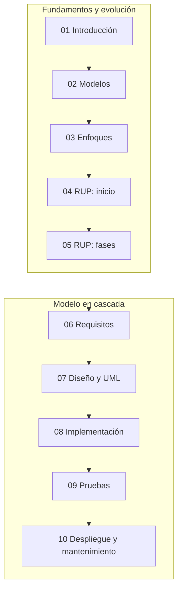

---
cssclasses:
  - recurso-portafolio
---
# Mapa del módulo

[[index|← Volver a inicio]]

El módulo se divide en dos partes: primero se revisan los fundamentos, la evolución de las metodologías y RUP; después se profundiza en las etapas del **modelo en cascada**. Este esquema permite ubicar cada tema y pasar directamente a su ficha.

## Relación conceptual entre bloques

Las primeras cinco fichas permiten comparar distintas formas de organizar el desarrollo. Las últimas cinco muestran, con mayor detalle, cómo se estructura uno de esos modelos: **cascada**, desde la definición de requisitos hasta el mantenimiento.
